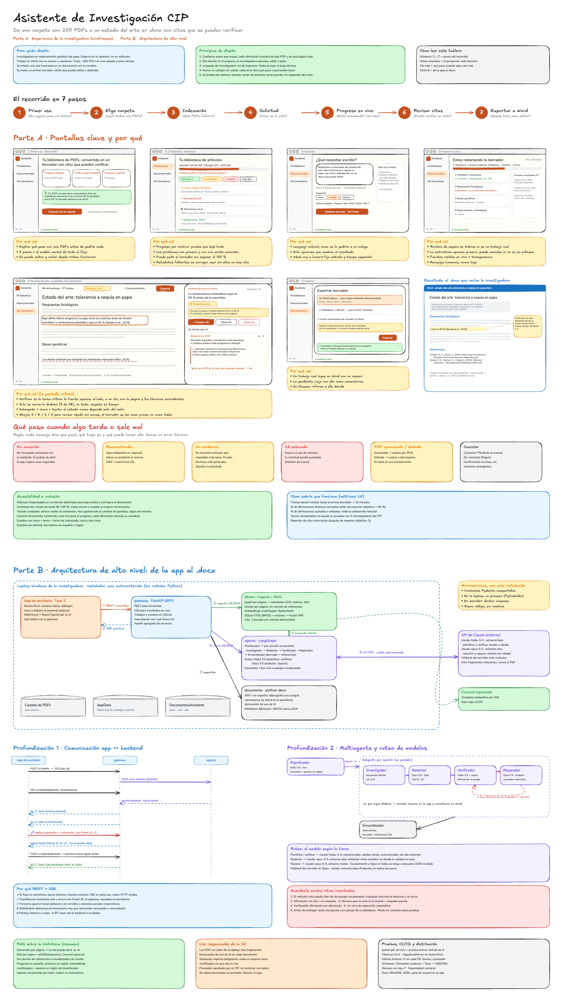
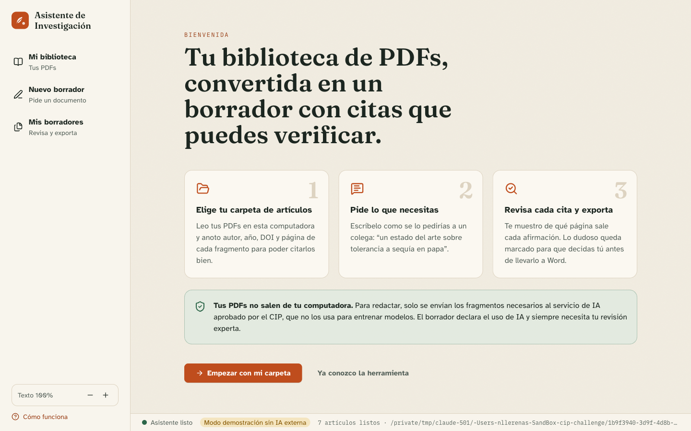
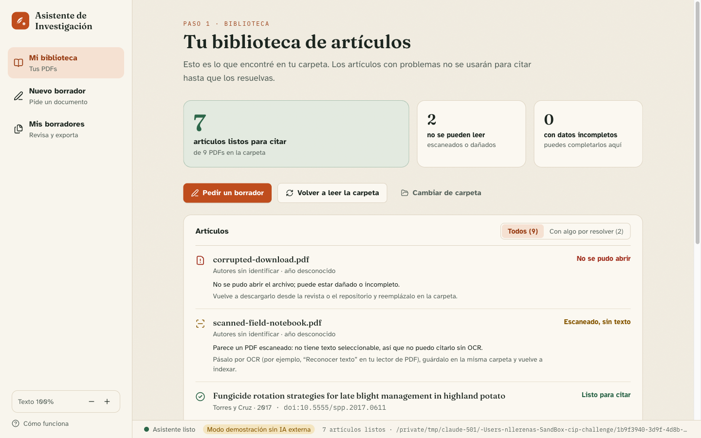
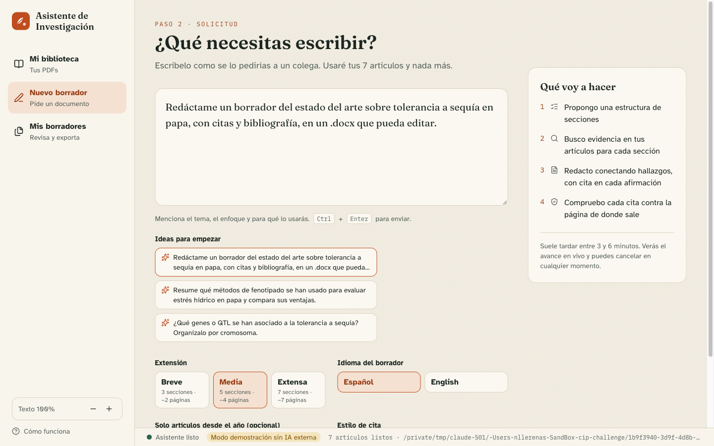
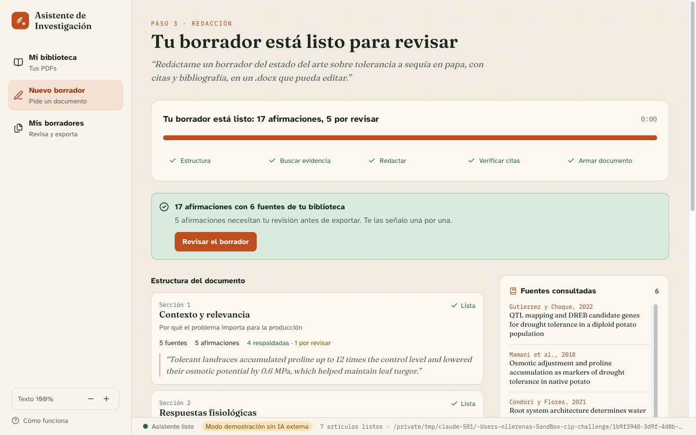
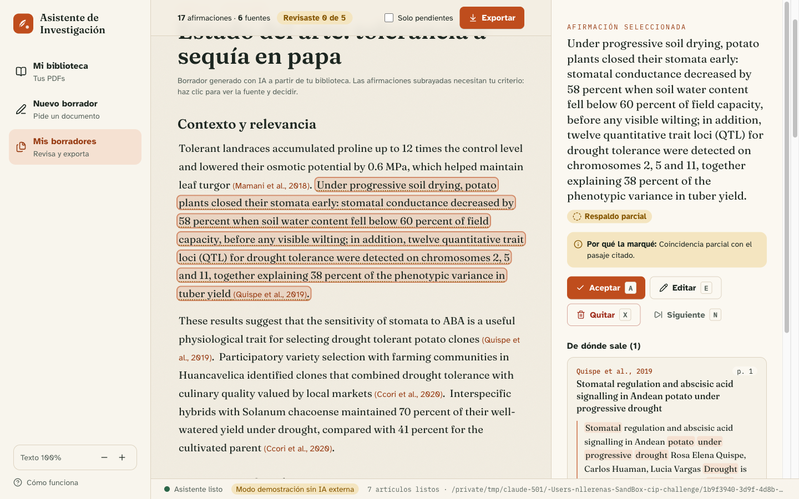
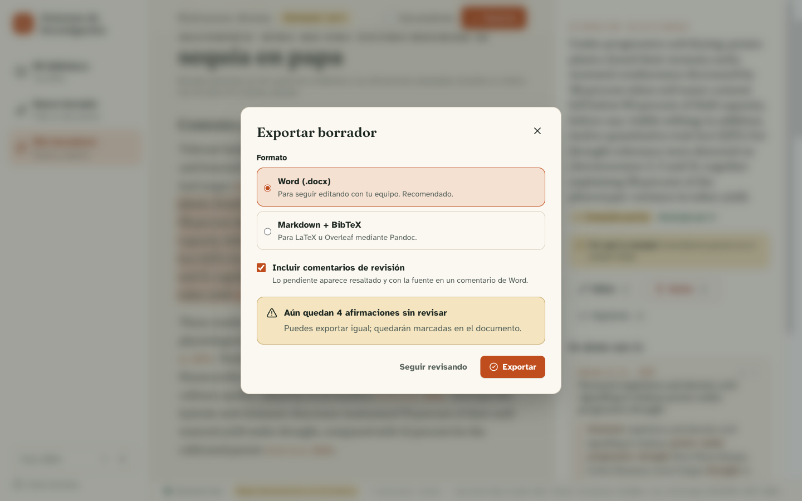
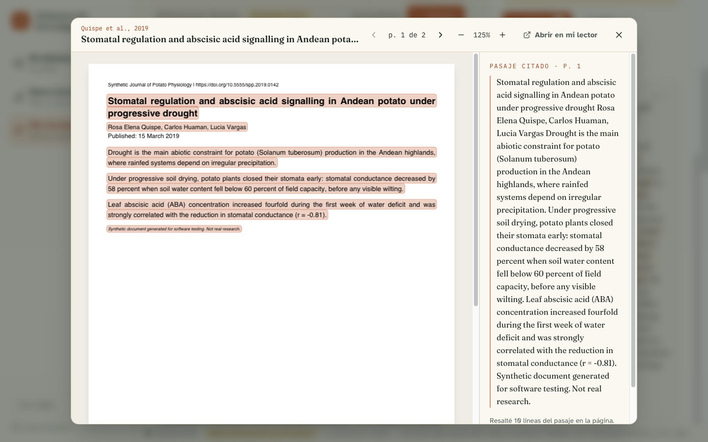
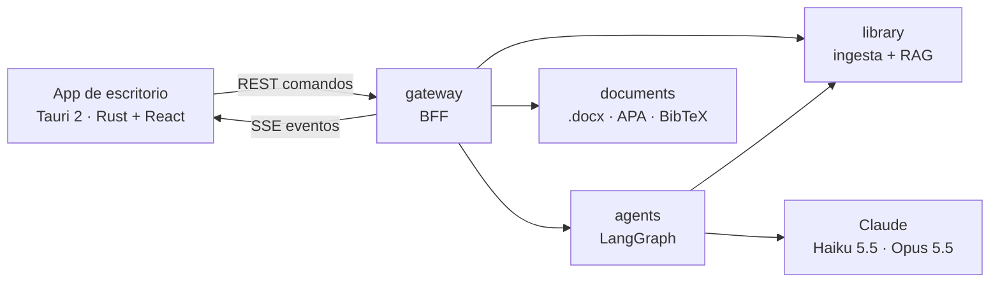

# Asistente de Investigación CIP

Propuesta para el reto técnico del CIP (*Practicante de IA y Desarrollo Full-Stack*). Una investigadora en mejoramiento genético de papa elige su carpeta con ~200 PDFs y pide:

> *“Redáctame un borrador del estado del arte sobre tolerancia a sequía en papa, con citas y bibliografía, en un .docx que pueda editar.”*

Este repositorio muestra cómo fluye esa solicitud de punta a punta, con el diseño de la experiencia, la arquitectura y un **prototipo funcional**.

| Entregable | Dónde |
|---|---|
| Tablero de Excalidraw (wireframes + arquitectura) | [`board/cip-research-assistant.excalidraw`](board/) |
| Guion del video de 5 minutos | [`docs/video-script.md`](docs/video-script.md) |
| Decisiones de UX | [`docs/ux.md`](docs/ux.md) |
| Arquitectura y profundizaciones | [`docs/architecture.md`](docs/architecture.md) · [ADRs](docs/adr) |
| Prototipo end-to-end | `apps/` + `services/` |



## La experiencia

| | |
|---|---|
|  **Bienvenida**: qué pasa con sus PDFs antes de pedirle nada |  **Biblioteca**: progreso por archivo y problemas explicados con una acción |
|  **Solicitud** en lenguaje natural, con pocas opciones |  **Progreso en vivo**: estructura, fuentes y verificación |
|  **Revisión**: cada afirmación con su pasaje y página |  **Exportar** a `.docx` con comentarios de revisión |
|  **Visor de PDF**: la cita en su página, con el pasaje resaltado | |

## La arquitectura



- **Microservicios** en Python 3.12 con contratos Pydantic compartidos (`packages/contracts`) y streaming NDJSON entre ellos.
- **REST + SSE reanudable** entre la app y el gateway (`Last-Event-ID`, eventos persistidos).
- **LangGraph**: planificador → por sección en paralelo (investigador → redactor → verificador ⟲ reparador) → ensamblador. **Ruteo**: Haiku para planificar y verificar, Opus para redactar.
- **Guardrails**: solo se citan pasajes recuperados, los números se comparan con la fuente y lo dudoso queda para revisión humana.
- **Windows autocontenido**: los servicios se empaquetan con PyInstaller como *sidecar* de Tauri → instalador NSIS/MSI generado en GitHub Actions.

## Probarlo

Requisitos: [uv](https://docs.astral.sh/uv/), Node 24 con pnpm, y Rust solo para compilar el instalador.

```bash
make install        # dependencias Python (workspace uv) y de la app
make samples        # corpus sintético de PDFs en ./samples
make dev            # backend en :8000 y app en http://localhost:1420
```

En el navegador, escribe la ruta absoluta de `./samples` en *Mi biblioteca*. En la app de escritorio (`cd apps/desktop && pnpm tauri dev`) se elige con el diálogo nativo.

**Con IA real:** exporta `ANTHROPIC_API_KEY` antes de `make dev`. Sin credenciales, el servicio `agents` usa un **modo demostración** extractivo y determinista (lo indica la barra inferior) para recorrer el flujo completo sin enviar datos a ningún proveedor.

| Variable | Valor por defecto | Para qué |
|---|---|---|
| `CIP_AGENTS_LLM_PROVIDER` | `auto` | `anthropic`, `offline` o `auto` (según haya credenciales) |
| `CIP_AGENTS_MODEL_FAST` / `_STRONG` | `claude-haiku-5-5` / `claude-opus-5-5` | Ruteo de modelos |
| `CIP_LIBRARY_EMBEDDER` | `hashing` | `fastembed` para embeddings multilingües (`uv sync --all-packages --all-extras`) |
| `CIP_LIBRARY_CROSSREF_ENABLED` | `false` | Completar metadatos por DOI (solo viaja el DOI) |
| `CIP_DATA_DIR` | `~/.cip-assistant` | Índice, trabajos y exportaciones del sidecar |

**Docker:** `PDF_LIBRARY=/ruta/a/tus/pdfs make docker-up` y abre la carpeta `/library` desde la app.

**Instalador de Windows:** el workflow [`Release Windows`](.github/workflows/release.yml) produce el `.exe` (NSIS) y el `.msi` como artefactos; con un tag `v*` crea un Release.

## Calidad

```bash
make test           # pytest (servicios + e2e) y Vitest
make lint           # ruff y tsc
```

CI en cada PR: servicios Python, UI (typecheck, pruebas y build), núcleo Rust (rustfmt + clippy), imágenes Docker e instalador de Windows cuando cambia el empaquetado.

## Estructura

```
apps/desktop          Tauri 2 (src-tauri, Rust) + React/TypeScript (src)
services/gateway      BFF: REST + SSE, trabajos y eventos
services/library      Ingesta de PDFs, metadatos de cita, búsqueda híbrida
services/agents       LangGraph, ruteo de modelos, guardrails
services/documents    .docx, Markdown y BibTeX
services/sidecar      Los 4 servicios en un proceso para la laptop
packages/contracts    Contratos Pydantic compartidos
packages/testkit      Corpus sintético de PDFs para pruebas y demos
tests/e2e             Recorrido completo con los servicios reales
board                 Tablero de Excalidraw (generado por código)
docs                  UX, arquitectura, ADRs y guion del video
deploy                Dockerfile y hooks de PyInstaller
```

## Cómo se trabajó

Cada bloque de trabajo es un issue (#1–#8) con criterios de aceptación, una rama y un PR con CI. Los PRs están apilados en el orden del flujo (contratos → library → documents → agents → gateway → desktop → empaquetado → documentación).
