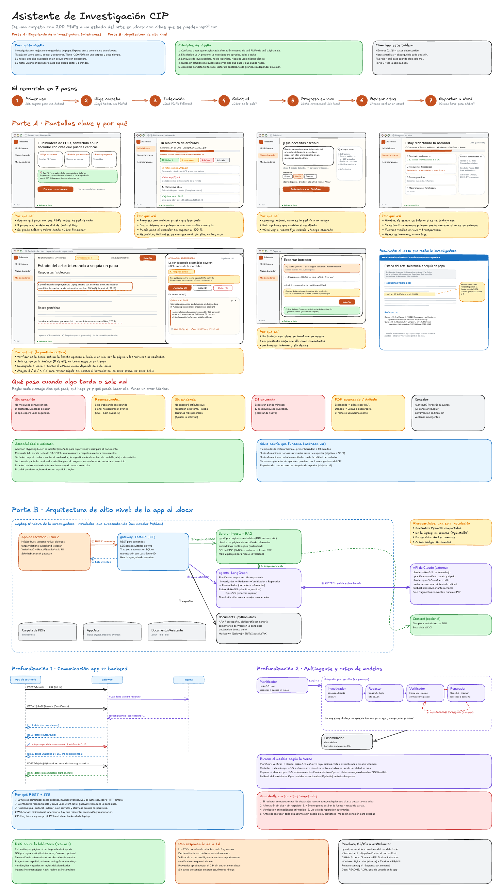

# Tablero de Excalidraw

`cip-research-assistant.excalidraw` es el entregable visual del reto:

- **Parte A · UX**: persona, principios, recorrido en 7 pasos, wireframes de cada pantalla con su *por qué*, el `.docx` resultante, estados de espera y error, accesibilidad y métricas.
- **Parte B · Arquitectura**: de la app de escritorio al documento, más las dos profundizaciones (comunicación app ↔ backend y orquestación multiagente con ruteo de modelos).



## Abrirlo
1. Entra a [excalidraw.com](https://excalidraw.com).
2. Menú → **Abrir** (`Ctrl+O`) y elige `cip-research-assistant.excalidraw`.
3. Para compartirlo: **Compartir → Enlace compartible**.

## Regenerarlo
El tablero se genera con código para poder versionarlo y revisarlo en PRs:

```bash
cd board && uv run python build_board.py
```

Después de abrirlo en Excalidraw se puede seguir editando a mano; lo dibujado a mano no se pierde mientras no se vuelva a ejecutar el script sobre el mismo archivo.
