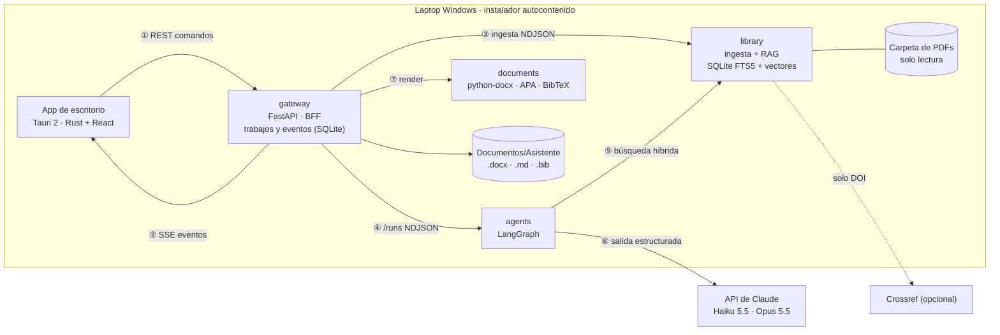
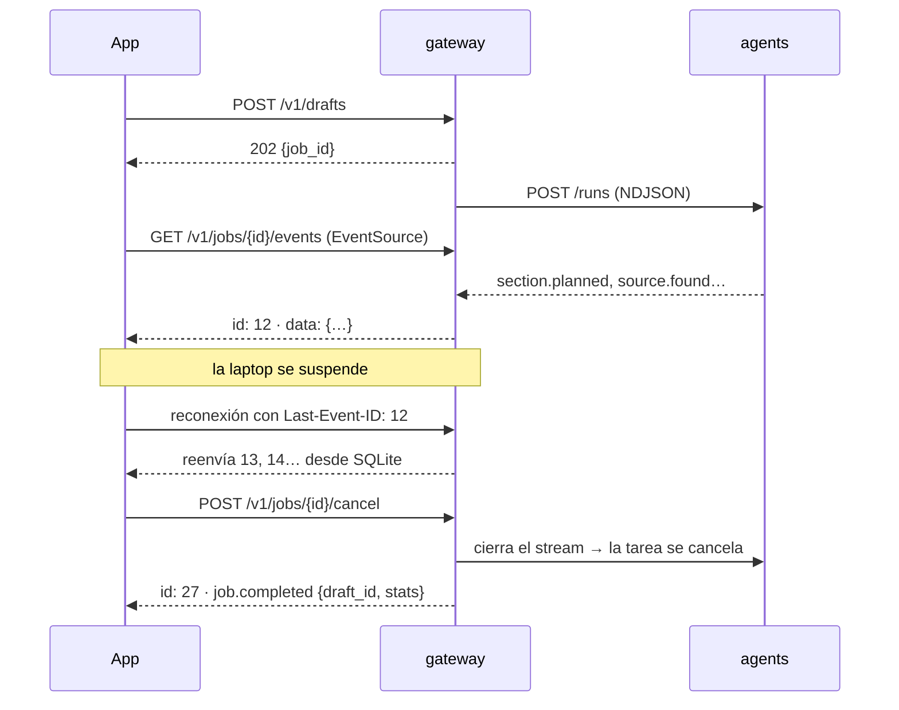
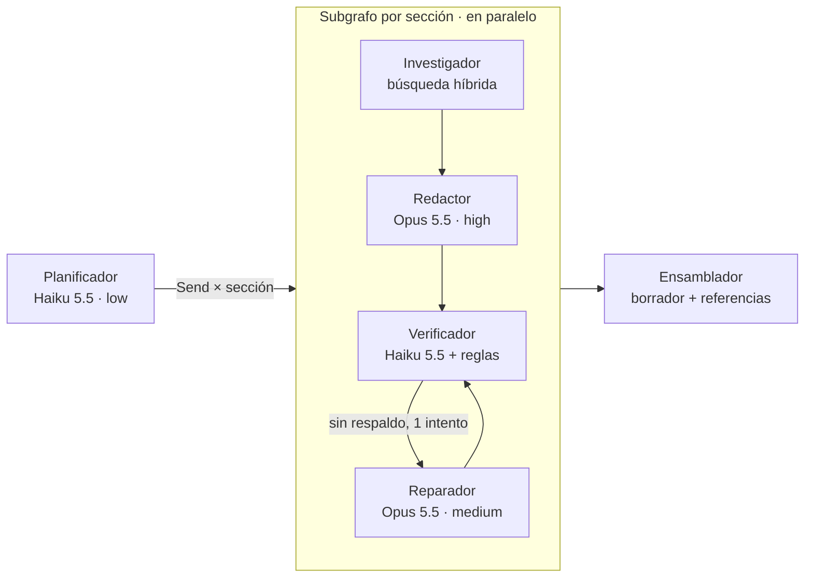

# Arquitectura

## Vista general

| Servicio | Responsabilidad | Tecnología |
|---|---|---|
| `apps/desktop` | Experiencia de la investigadora; lanza el backend como *sidecar* | Tauri 2 (Rust), React 19, TypeScript, Tailwind 4 |
| `services/gateway` | Único punto de entrada; REST + SSE; trabajos, eventos y borradores persistidos | FastAPI, httpx, SQLite |
| `services/library` | Ingesta de PDFs, metadatos de cita, búsqueda híbrida | pypdf, langchain-text-splitters, SQLite FTS5, numpy, fastembed (opcional) |
| `services/agents` | Orquestación multiagente y ruteo de modelos | LangGraph, SDK de Anthropic, salidas estructuradas Pydantic |
| `services/documents` | `.docx`, Markdown y BibTeX con citas y bibliografía | python-docx |
| `packages/contracts` | Contratos compartidos (eventos, pasajes, borrador, referencias) | Pydantic |
| `services/sidecar` | Ejecuta los 4 servicios en un proceso para la laptop | uvicorn, PyInstaller |

Los servicios solo se comunican por HTTP con los contratos de `cip-contracts`. Los flujos largos (ingesta y redacción) viajan como **NDJSON en streaming** entre servicios, y el gateway los traduce a **SSE** para la app.

## Profundización 1 · Comunicación app ↔ backend

**Por qué REST + SSE**
- El flujo es asimétrico: pocas órdenes y muchos eventos; SSE es exactamente eso, sobre HTTP simple.
- `EventSource` reconecta solo y envía `Last-Event-ID`; el gateway persiste los eventos y reproduce lo pendiente. Un reinicio del gateway cierra los trabajos huérfanos con un mensaje claro.
- Heartbeats (`: ping`) para proxies; el SSE lleva ids y estadísticas, no el borrador completo (se pide por REST).
- El mismo contrato sirve con el backend local (sidecar) o remoto.
- Descartado: **WebSocket** (bidireccional innecesario, reconexión y reanudación manuales), **polling** (latencia y carga) e **IPC de Tauri** (ataría el backend al proceso de escritorio).

## Profundización 2 · Multiagente y ruteo de modelos

| Tarea | Modelo | Esfuerzo | Por qué |
|---|---|---|---|
| Planificar | `claude-haiku-5-5` | low | Salida corta y estructurada |
| Verificar | `claude-haiku-5-5` | low | Juicio acotado afirmación-vs-pasaje, en lote por sección |
| Redactar | `claude-opus-5-5` | high | La síntesis entre estudios es donde se nota la calidad |
| Reparar | `claude-opus-5-5` | medium | Reescribir con precisión o descartar |

- Si Haiku se niega o devuelve una salida inválida, la tarea **escala a Opus**. En Opus se activa el **fallback del servidor** (`fallbacks: "default"`, beta `server-side-fallback-2026-07-01`).
- Todas las llamadas usan **salidas estructuradas** (`client.beta.messages.parse` con modelos Pydantic): no se parsea texto libre.
- El progreso sale de los nodos con `get_stream_writer()` y se consume con `astream(stream_mode=["custom", "values"], subgraphs=True, version="v2")`.
- **Modo sin conexión**: sin credenciales, un modelo extractivo y determinista recorre el mismo grafo (CI y demos sin enviar datos).

### Guardrails contra citas inventadas
1. El redactor recibe pasajes etiquetados `E1…En` y solo puede citar esas etiquetas; cualquier otra se descarta y se avisa.
2. Una afirmación sin cita queda como *sin respaldo*.
3. Verificación afirmación por afirmación contra los pasajes citados (respaldada / parcial / sin respaldo).
4. Regla determinista: un número que no aparece en la fuente baja la afirmación a *parcial*.
5. Un ciclo de reparación automática; lo que sigue dudoso pasa a revisión humana (app y comentarios de Word).
6. `assert_citations_are_grounded`: antes de entregar, toda cita apunta a un pasaje de la biblioteca.
7. Deduplicación entre secciones.

## RAG sobre la biblioteca

- **Extracción por página** con pypdf (BSD). Se descartó PyMuPDF por su licencia AGPL en una app distribuida.
- **Metadatos**: DOI por regex, año de publicación (prioriza *Published/Accepted/©*), título y autores desde la información del PDF. Crossref es opcional y solo recibe el DOI.
- **Chunking** por página con `RecursiveCharacterTextSplitter`: se eliminan las líneas de ruido (URLs, DOI, sellos de publicación) y la sección de referencias, para que una búsqueda no devuelva títulos citados.
- **Índice embebido**: SQLite con FTS5 (BM25) y embeddings en la misma base; fusión **RRF** y un máximo de 2 pasajes por artículo. `hashing` (determinista, para CI) o `fastembed` con `paraphrase-multilingual-MiniLM-L12-v2`, para que una pregunta en español encuentre artículos en inglés; además, el planificador genera las búsquedas en inglés.
- **Ingesta incremental** por hash de contenido: reabrir la carpeta es instantáneo y los archivos borrados salen del índice.
- Cada pasaje conserva `paper_id`, página, archivo y metadatos → la cita APA y el enlace *Abrir PDF (p. N)* salen de ahí.

## Evaluación de calidad

`make eval` (paquete `packages/evals`, con pandas y scikit-learn) mide tres cosas sobre el corpus sintético y falla si alguna cae bajo su umbral. En CI publica el reporte en el resumen de GitHub Actions y como artefacto.

| Suite | Qué mide | Cómo |
|---|---|---|
| Recuperación | ¿La evidencia correcta sale primero? | 14 consultas con su artículo esperado (10 en inglés, 4 en español) → recall@1, recall@5, MRR por idioma |
| Verificador | ¿Detecta afirmaciones con números alterados, temas ajenos o contradicciones? | 12 afirmaciones etiquetadas → exactitud, F1 macro y matriz de confusión |
| Punta a punta | ¿El borrador queda anclado a la biblioteca? | Borrador completo → % respaldadas, citas por afirmación, fuentes y 0 citas fuera de la biblioteca |

Por defecto no llama a ningún proveedor; `uv run cip-eval --provider anthropic` evalúa el verificador real (tiene costo).

**Línea base (modo sin conexión, embeddings `hashing`):**

| Métrica | Valor | Lectura |
|---|---|---|
| Recuperación en inglés: recall@5 / MRR | 1.00 / 1.00 | La búsqueda híbrida encuentra la evidencia correcta y primero |
| Recuperación con consultas en español: recall@1 / MRR | 0.25 / 0.38 | Con embeddings no multilingües, preguntar en español falla. Por eso el planificador genera las búsquedas en inglés y en producción se usan embeddings multilingües |
| …con `--embedder fastembed` (`paraphrase-multilingual-MiniLM-L12-v2`) | **1.00 / 1.00** | La misma pregunta en español encuentra el artículo en inglés: la decisión de usar embeddings multilingües, medida |
| Verificador: exactitud / F1 macro | 0.92 / 0.90 | La regla de números atrapa todos los valores alterados; el único error es una **contradicción** que un verificador léxico no puede detectar: es trabajo del verificador con LLM |
| Borrador: citas fuera de la biblioteca | 0 | Garantizado por los guardrails |

## Documento final

- `.docx` con estilos nativos de Word, APA 7 en español (`y`, `et al.`, `s.f.`, desambiguación `2023a/2023b`), bibliografía con sangría francesa y declaración de uso de IA.
- Lo pendiente queda resaltado con un **comentario de Word** que incluye el motivo y la fuente con página.
- Markdown con citas Pandoc (`[@clave]`) + `references.bib`: `pandoc --citeproc` lo lleva a LaTeX (hay una prueba automatizada).

## Pruebas, CI/CD y distribución

- `pytest` por servicio + `tests/e2e` (los 4 servicios reales en proceso vía ASGI) · Vitest en la UI · `cargo clippy -D warnings` y `rustfmt` en el núcleo Rust.
- GitHub Actions: CI en cada PR (Python, UI, Rust, Docker) y `release.yml` en `windows-latest`: PyInstaller → sidecar → `tauri build` → instaladores **NSIS** (por usuario, sin administrador) y **MSI** (para TI), con el bootstrapper de WebView2. Los tags `v*` crean un Release borrador.
- Servidor o laboratorio: `docker compose up` con contenedores sin privilegios y healthchecks.
- Dependabot semanal para Actions y dependencias Python.
