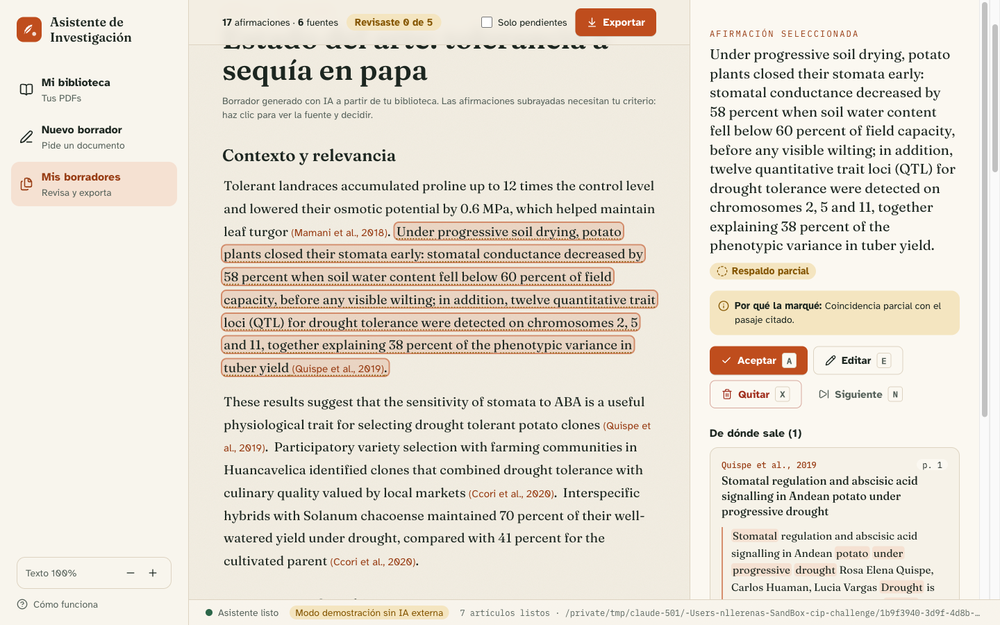

# Experiencia de usuario

## Para quién

Una investigadora en mejoramiento genético de papa. Es experta en su dominio, no en software. Trabaja en Word con su asesor y sus coautores, tiene unos 200 PDFs en una carpeta y poco tiempo. **Su mayor riesgo es firmar una afirmación o una cita que no existe.**

## Principios

1. **Confianza antes que magia.** Cada afirmación muestra de qué PDF y de qué página sale.
2. **Ella decide.** La IA propone; la investigadora acepta, edita o quita.
3. **Su lenguaje.** Nada de logs, ids ni jerga técnica en la interfaz.
4. **Nunca un callejón sin salida.** Cada error dice qué pasó y qué puede hacer.
5. **Accesible por defecto.**

## Recorrido

| # | Pantalla | Pregunta que responde | Decisiones clave |
|---|---|---|---|
| 1 | Bienvenida | ¿Es seguro para mis datos? | Privacidad explicada antes de pedir nada; 3 pasos = modelo mental del flujo; se puede saltar y volver desde *Cómo funciona* |
| 2–3 | Biblioteca | ¿Leyó todos mis PDFs? | Progreso archivo por archivo; problemas primero y con acción (OCR, volver a descargar, completar metadatos); puede pedir el borrador antes del 100 % |
| 4 | Solicitud | ¿Cómo se lo pido? | Lenguaje natural con ejemplos; pocas opciones (extensión, idioma, desde año); *Qué voy a hacer* con método y tiempo esperado; `Ctrl+Enter` |
| 5 | Progreso | ¿Está avanzando? | Etapas en lenguaje humano; la estructura aparece primero (cancelar si no es el enfoque); fuentes en vivo; cancelación con confirmación en línea; aviso de reconexión |
| 6 | Revisión | ¿Puedo confiar? | Prosa continua; solo lo dudoso subrayado (punteado = parcial, ondulado = sin respaldo); panel con pasaje, página, términos coincidentes y motivo; **visor de PDF integrado** que abre la página citada con el pasaje resaltado; atajos `A`/`E`/`X`/`N`; contador *Revisaste n de m* |
| 7 | Exportar | ¿Queda listo para Word? | `.docx` con estilos nativos, APA 7, bibliografía, declaración de IA y comentarios de Word en lo pendiente; Markdown + BibTeX para LaTeX; no se bloquea la exportación |

## Esperas, errores y resultados vacíos

| Situación | Mensaje | Acción ofrecida |
|---|---|---|
| Backend no responde | “No me puedo comunicar con el asistente…” | Esperar o reabrir la app; indicador en la barra inferior |
| SSE se corta | “Reconectando… no perderás el avance” | Automática (`Last-Event-ID`) |
| Carpeta sin PDFs | “No encontré PDFs en esta carpeta” | Elegir otra carpeta |
| PDF escaneado o dañado | Explicación por archivo | OCR o volver a descargar; el resto se usa |
| Metadatos incompletos | “Faltan datos para citarlo: año” | Formulario en la misma fila |
| Sin evidencia para el tema | “No encontré artículos que respalden este tema” | Sugerencias + *Ajustar la solicitud* |
| IA saturada / sin credenciales | Mensaje traducido, nunca un código | *Intentar de nuevo*; la solicitud queda guardada |
| Cancelación | Confirmación en línea | *Sí, cancelar* / *Seguir redactando* |

## Accesibilidad

- **Atkinson Hyperlegible** en la interfaz (diseñada para baja visión) y Fraunces para el documento; fuentes empaquetadas, sin depender de internet.
- Contraste AA en ambos temas (claro/oscuro), escala de texto 90–130 %, `prefers-reduced-motion`.
- Teclado completo: enlace *Saltar al contenido*, foco movido al título al cambiar de pantalla, atajos en la revisión, diálogo nativo `<dialog>` con trampa de foco.
- Lectores de pantalla: landmarks, `aria-live` para el progreso y la conexión, cada afirmación anuncia su veredicto, barras de progreso con `role="progressbar"`.
- Ningún estado depende solo del color: icono + texto + forma del subrayado.

## Cómo sabría que funciona

- Tiempo desde la instalación hasta el primer borrador < 10 minutos.
- > 90 % de afirmaciones dudosas revisadas antes de exportar.
- % de afirmaciones quitadas o editadas (mide la calidad del redactor).
- Tareas completadas sin ayuda en pruebas con 5 investigadoras.
- 0 reportes de citas incorrectas después de exportar.
